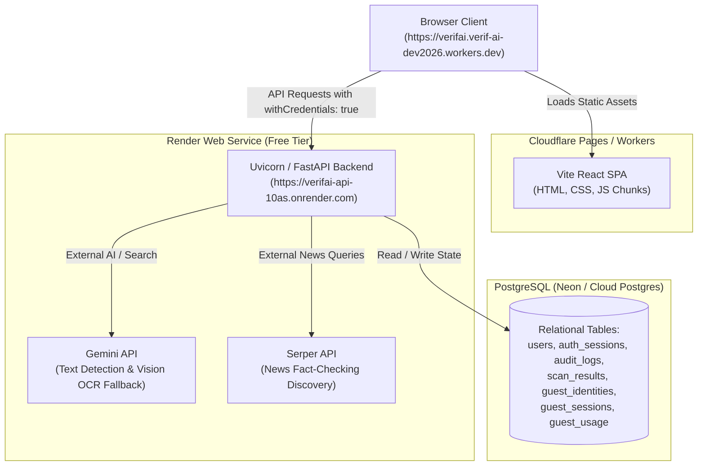

# VeriFai Deployment Handout & Architecture State

This document provides a clean, consolidated summary of the deployment configuration, what has been changed, how the system communicates across Cloudflare and Render, and what to verify next.

---

## 1. System Architecture Overview

---

## 2. Issues Encountered & Concrete Fixes Applied

| # | Component | Symptoms / Error | Root Cause | Fix Applied | Commit |
|---|---|---|---|---|---|
| **1** | **Backend Build** | `No matching distribution found for paddlepaddle==3.2.2` | Python 3.14 on Linux lacks pre-built wheels for PaddlePaddle; also ML weights exceed Render's 512MB RAM. | Removed local PyTorch/PaddleOCR requirements from `requirements.txt` since the app already migrated to the Gemini API backend. | `e6ffc1a` |
| **2** | **Frontend Routing** | Cloudflare Pages deployment failed with `Infinite loop detected in _redirects` | Cloudflare Pages with Vite automatically handles SPA rewrites. Adding `/* /index.html 200` caused a redirect loop error. | Removed `_redirects` file entirely; Cloudflare native SPA routing handles deep links automatically. | `8a50309` |
| **3** | **Backend Build** | `psycopg-binary==3.2.9 not found` on Python 3.14 | Strict version pinning prevented pip from using Python 3.14 compatible binary wheels (>=3.2.10). | Replaced strict equality (`==`) with lower-bound ranges (`>=`) across `requirements.txt`. | `d3a52ca` |
| **4** | **Backend Startup** | `ValidationError: 1 validation error for Settings: jwt_secret` | The literal command string `'openssl rand -hex 32'` was pasted into the Render environment instead of the generated random token. | Generated and assigned a genuine 64-character hex secret string. | Manual Env Update |
| **5** | **Frontend API Target** | `POST .../api/v1/detector/image 405 Method Not Allowed` | Frontend had no `VITE_API_URL` baked into its build bundle, falling back to relative paths on Cloudflare. | Updated `src/lib/api.ts` to default production calls to `https://verifai-api-10as.onrender.com/api/v1`. | `9fd7ddf` |
| **6** | **CORS & Preflight** | `Blocked by CORS policy: No 'Access-Control-Allow-Origin' header` | 1) `main.py` lacked `*.workers.dev` in its origin regex. 2) `TrustedHostMiddleware` executed before `CORSMiddleware`, blocking `OPTIONS` preflight before CORS headers could be written. | 1) Added `*.workers.dev` and `*.pages.dev` to `allow_origin_regex`. 2) Reordered Starlette middlewares so `CORSMiddleware` executes outermost. 3) Added `*.onrender.com` to `trusted_hosts`. | `81667c1`, `d1b480d` |
| **7** | **Database Persistence** | `POST /guest/consent` & `POST /auth/register` returning `500 Internal Server Error` | Clean cloud Postgres database had no tables initialized. `create_all` initially crashed due to a single misspelled model import name. | Updated `lifespan` in `app/main.py` to import whole model modules and run `Base.metadata.create_all(bind=engine)` automatically on boot. | `5cfd936`, `0c1b0d0` |

---

## 3. Required Environment Variables Reference

### Render Backend (`verifai-api-10as`)
* `DATABASE_URL`: `postgresql+psycopg://...?...sslmode=require`
* `ENVIRONMENT`: `staging` *(avoids strict Redis & SMTP enforcement on free tier)*
* `CORS_ORIGINS`: `https://verifai.verif-ai-dev2026.workers.dev`
* `COOKIE_SECURE`: `true`
* `COOKIE_SAMESITE`: `none`
* `JWT_SECRET`: `8f1abc7418cc730541f0d442627f4d701bd11f208cf10d551a0c3a5fcd17380b`
* `DATA_ENCRYPTION_KEY`: *(Fernet key generated earlier)*
* `TEXT_ANALYZER_BACKEND`: `gemini`
* `GEMINI_API_KEYS`: *(Comma-separated Gemini keys)*
* `SERPER_API_KEYS`: `5a68b44de1b6a0d9dc48ce0712ef35731bf6bbf5,c7898ecfcfe6681d7459edc11c3c18733db8a1e6,a1b88fd0928cbb988c79123ebc677ace122bf593`
* `IMAGE_OCR_WARMUP`: `false`
* `TEXT_MODEL_WARMUP`: `false`

### Cloudflare Pages / Workers Frontend (`verifai`)
* `VITE_API_URL`: `https://verifai-api-10as.onrender.com/api/v1`

---

## 4. Verification Checklist

1. [ ] **Render Deploy Status:** Confirm latest commit (`0c1b0d0`) status is green ("Live").
2. [ ] **Open Frontend:** Visit `https://verifai.verif-ai-dev2026.workers.dev` (use Hard Refresh: `Ctrl + F5`).
3. [ ] **Guest Consent / Scanner Test:**
   * Run a text scan without logging in.
   * Expect: `POST /api/v1/guest/consent` returns `200 OK`, followed by `POST /api/v1/guest/detect-text` returning `200 OK`.
4. [ ] **User Registration Test:**
   * Go to `/register`.
   * Register with a valid password (≥12 characters, uppercase, lowercase, number, symbol: e.g. `VeriFai#2026!Secure`).
   * Expect: Redirect to `/dashboard`.
